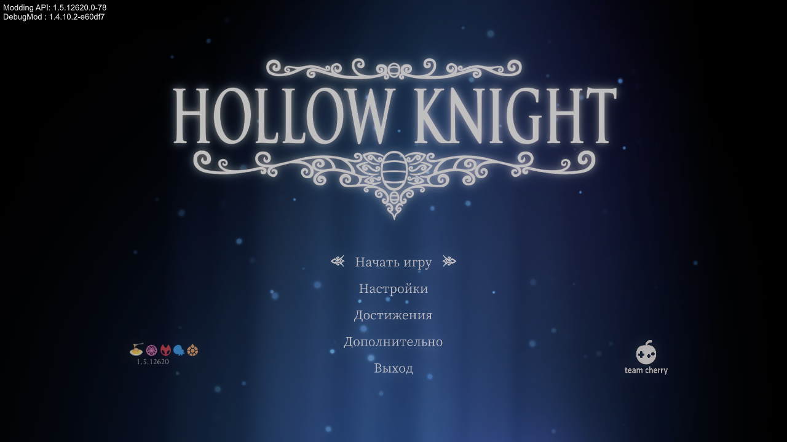
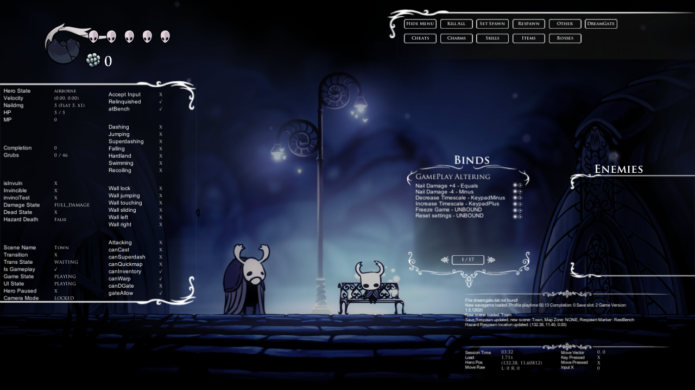

# Проверка Scarab Modern 2.8.4

Проверено 18.10.2026 на Windows x64, Steam Hollow Knight 1.5.12620 (build 22529139), Unity 6000.0.61f1.

- 52 теста менеджера: успешно.
- HookGen: старые сигнатуры, перенаправление типов, подписки на хуки, невалидные фасады — успешно.
- Встроенные исходники API v78: SHA-256, лицензии и точное совпадение с vendor/api проверены.
- API собран из встроенного ZIP с DLL установленной игры, в том числе при наличии оставшихся старых MonoMod/Cecil.
- Через Installer проверены установка, выключение, включение, удаление и повторная установка DebugMod 1.4.10.2; полный переход API → vanilla → API.
- Игра запущена с авторизацией Steam; API 1.5.12620.0-78 и DebugMod 1.4.10.2-e60df7 загрузились, предзагрузка завершилась, Debug зарегистрировал 122 команды.
- Существующее сохранение загрузилось в Town, панели Debug отображаются; F1 скрывает и возвращает их.
- Изменения API при работающей игре блокируются.
- Готовый менеджер собран и запущен; каталог модов загрузился.
- Перед проверкой созданы локальные резервные копии; исходные файлы сохранений после проверки не изменились.

API основан на [hk-modding/api PR #164](https://github.com/hk-modding/api/pull/164) и [SFGrenade/api PR #5](https://github.com/SFGrenade/api/pull/5). Это экспериментальные изменения сообщества, а не официальный стабильный релиз API.

Другие моды, Linux/macOS, все команды Debug и полное прохождение не проверены. Логи, сохранения, DLL игры и локальные пути резервных копий не входят в репозиторий.
